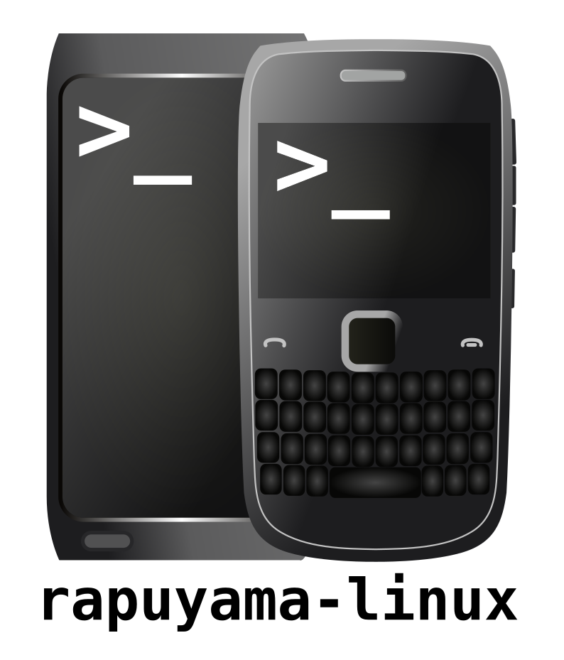

# rapuyama-linux



**A Linux bring-up for the RapuYama hardware platform replacing Symbian at runtime.**

This project takes over the phone from a running Symbian installation, hands control to an ARM Linux kernel, and brings up the RapuYama application SoC.
It combines Symbian-side loaders and hardware probes, reverse engineering of Nokia's firmware, and experimental Linux drivers.

> **Current status: Linux boots on the phone.** The checked-in successful boot log shows the RapuYama interrupt controller receiving the timer IRQ, the kernel switching to its RapuYama clocksource, and BusyBox `/init` starting. The current USB gadget setup also provides an interactive shell over USB serial.

## The hardware

| Component | What we know |
| --- | --- |
| Application CPU | ARM1176JZF-S, ARMv6K |
| SoC | Nokia RapuYama |
| RAM | 256 MiB at physical `0x10000000` |
| Display | Broadcom BCM2727 / VideoCore |
| Boot environment | Symbian^3 / EKA2, with a one-way handoff to Linux |
| Kernel | Linux 6.12, built for ARMv6 |

This is a device-specific port, not a generic EKA2 compatibility layer. Some work may carry over to other phones using the same SoC, but each model still needs its own board description, memory and boot validation, and peripheral bring-up.

## What is here

- **Symbian takeover and probes** - inspect memory mappings and peripheral registers, run small ARM payloads, and transfer control to Linux.
- **Linux kernel port** - an ARMv6 kernel configuration plus experimental RapuYama support for interrupt handling, timers, GPIO, clocks, watchdog, UART, and other peripherals.
- **RAM-backed early logging** - preserve early kernel output in reserved RAM so it can be retrieved after a failed boot, even without a serial console.
- **Hardware notes** - reverse-engineering results from firmware analysis and live probes.

The basic boot, timer/IRQ path, initramfs userspace, and USB serial shell have been exercised on the phone. Other devices and drivers remain experimental, their presence in the tree does not imply that they have been validated on hardware.

## Build the kernel

On a Linux host, install an ARM GNU EABI cross-toolchain (`arm-linux-gnu-gcc` and binutils), then initialize the kernel submodule and build:

```sh
git submodule update --init --depth 1 linux/kernel/linux
cd linux/kernel
./build-kernel.sh e6config
./build-kernel.sh build
```

The kernel image is written to:

```text
linux/kernel/build/arch/arm/boot/zImage
```

The build script uses `ARCH=arm`, `CROSS_COMPILE=arm-linux-gnu-`, and all available CPU cores by default. `e6config` installs the checked-in E6 configuration, `build` builds the kernel image and the kernel tree's DTBs.

## Build the Nokia E6 device tree

The board DTB used by the E6 loader comes from `linux/boot/e6.dts`. It is separate from the DTBs built by the kernel target above. After building the kernel (which also builds the in-tree `dtc` compiler), run this from the repository root:

```sh
linux/kernel/build/scripts/dtc/dtc -I dts -O dtb -o linux/boot/e6.dtb linux/boot/e6.dts
```

The resulting `linux/boot/e6.dtb` is the board description to pair with the kernel image. If you change the DTS, rebuild this file before deploying it.

## Boot flow

```text
Symbian
  |_ boot.sis / boot.exe
       |_ loads zImage and e6.dtb into physical RAM
       |_ prepares the handoff (MMU and caches off)
       |_ jumps to the Linux ARM kernel
            |_ early log is captured in reserved RAM
```

The loader places the kernel image and DTB in a contiguous physical chunk and passes the DTB address to Linux. The E6 kernel is configured with the fixed physical RAM base `0x10000000`.This avoids deriving the kernel's memory base
from the loader's variable chunk address.

The phone-side package and boot sequence are documented in
[`linux/boot/README.md`](linux/boot/README.md). That guide includes the expected files, recovery/diagnostic notes, and the distinction between normal and probe images. Do not mistake a diagnostic probe image for the regular `zImage`.

For the interactive USB shell, use the USB-enabled DTB as `E:\e6.dtb`, connect the phone to the host over USB, and start the boot package. On a Linux host, connect to the enumerated gadget serial port, typically:

```sh
picocom -b 115200 /dev/ttyACM0
```

The shell runs on the phone's `ttyGS0`. `picocom` provides the host-side terminal. The USB-enabled DTB opts into this shell, while the base DTB uses the non-interactive init path.

## Repository map

| Path | Contents |
| --- | --- |
| [`linux/kernel/`](linux/kernel/) | Kernel configuration, build script, and kernel source submodule |
| [`linux/boot/`](linux/boot/) | E6 DTS, trampoline, and boot documentation |
| [`linux/stage0/`](linux/stage0/) | Symbian-side loader and low-level experiments |
| [`driver/`](driver/) | Symbian kernel drivers, SIS packaging, and deployment notes |
| [`tools/`](tools/) | Log parsers and reverse-engineering utilities |
| [`docs/`](docs/) | Hardware maps, driver notes, and investigation reports |
| [`logs/`](logs/) | Captured output from experiments |

## Notes and references

- [Linux bring-up notes](linux/README.md)
- [Kernel build guide](linux/kernel/README.md)
- [Boot pipeline and phone-side instructions](linux/boot/README.md)
- [RapuYama driver reverse engineering](docs/driver-re.md)
- [Hardware memory map](docs/hw-memory-map.md)
- [ROM analysis notes](docs/rom-analysis.md)

## Current boundaries

- This is an early userspace bring-up, not yet a complete everyday phone OS.
- The display is not currently a dependable way to observe Linux startup.
- Treat register addresses and undocumented peripheral behavior as hypotheses unless the notes explicitly say they were checked on live hardware.
- A successful boot does not imply that every peripheral or power-management path is implemented.
- The boot handoff is one-way. A failed run may require the phone's watchdog reset to recover.