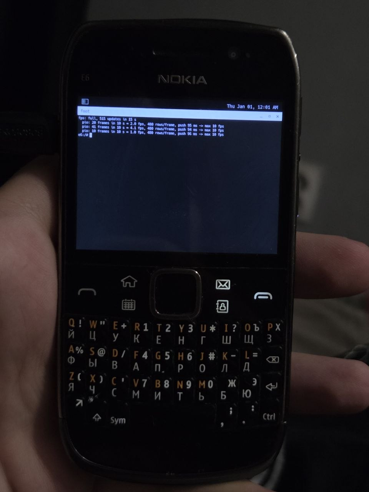
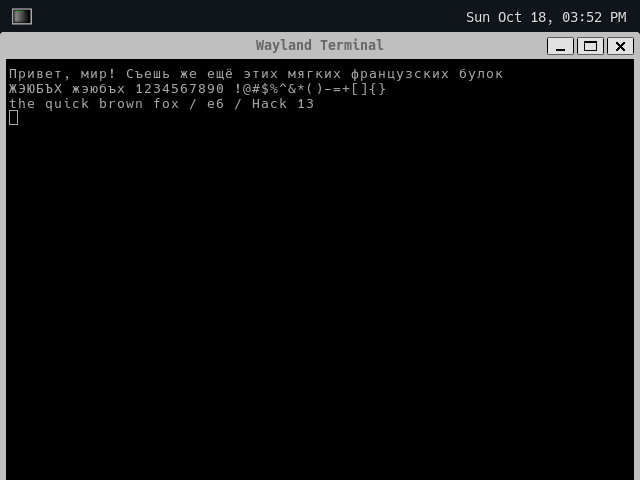

# Nokia E6 display: BCM2727B1 VideoCore III from Linux

## Status

**Linux shows an image on the E6 panel** (14.10.2026). The kernel driver `drivers/soc/rapuyama/videocore.c` does the following:

1. Boots the VideoCore over the ViSSI host bus with Nokia's own firmware.
2. Brings up VCHI.
3. Powers the LCD panel up the way Symbian does.
4. Exposes a 640x480 XRGB8888 KMS device (`/dev/dri/card0`), plus `/dev/fb0` through the drm fbdev emulation.
5. Pushes the frame to the VideoCore whenever it changes.

fbcon runs on it, so the kernel console and the shell are visible on the phone itself. The log of the first run is in [`first-display_SUCCESS.log`](first-display_SUCCESS.log).

## Wayland (runs on the phone since 18.10.2026)

Daily config: `Image` + `e6-vc-565.dtb` from `build-vc.sh` (`videocore.dma=1 videocore.rgb565=1`), booted with `e6bfix.sis` (see [`../linux/boot/README.md`](../linux/boot/README.md)). ~9-16 fps full screen, picture correct.

- the fbdev layer of `videocore.c` is a tiny KMS driver (simple display pipe, gem shmem, shadow plane, `late_initcall` so drm core is up first). a commit copies the damage into `vc->fb` and wakes the push thread. fake vblank events, 60 Hz mode, frames that come faster than the bus are merged
- weston sends a commit with no damage clips before every real one, the helper calls that a full screen update -> 0-clip commits are diffed row by row against `vc->fb`
- userspace = alpine 3.24 armhf (`linux/initramfs/alpine.sh`, pruned by `tools/prune_rootfs.py`): seatd + weston (pixman) + `foot` (redraws only changed cells, weston-terminal redrew the whole window on every key)
- keyboard: `linux/initramfs/xkb-e6`. fn = level 3 (yellow symbols), sym = en/ru, fn+space = tab, fn+backspace = escape
- `fps` / `fps line` in the shell: full screen scroll / one line counter for 12 s, then the driver's 10 s push stats as fps




## Speed (18.10.2026)

| what | fps on the phone |
|---|---|
| PIO, XRGB8888, full frame | ~5 |
| gfx dma, XRGB8888 | 5-6 (after the sleep fix, 2 before) |
| gfx dma, RGB565 | 9 (scroll), 16 (`fps`) |
| gfx dma, RGB565, partial (broken picture) | 16 / 28 (`fps line`) |

- **the ViSSI bus is the limit**: ~277 ns per 16-bit word, ~7 MB/s, the same with PIO and dma. dma only frees the cpu. bus timings = Symbian's
- **gfx dma** (`0x20024800`, vcdriver FUN_8032a154 / FUN_80329ec8): divider from the pll (<= 173 MHz) + reset + regs, done in `vc_boot` right after the bus init with the VC held in reset (after "display up" it killed the phone). the Symbian self test (test mode `0x700000` + go) also kills the phone, so there is none. VCHI tx slots go by dma too (Symbian: PIO only <= 48 bytes)
- **timer**: timer-rapuyama is periodic only, no high res timers, every sleep is a 10-20 ms jiffy. the reply wait spins ~2 ms, the dma wait never sleeps
- **RGB565**: vcdispman FUN_80345920/74/c8 map Symbian formats: `4` = res `0x2b` / buf `0x20008` / 32 bpp (default), `0x10` = `5` / `0x20005` / 24, `0x20` = `1` / `0x20004` / 16 (`videocore.rgb565=1`)
- **partial push does not work**: the real VC ignores the BFMX write rects and always writes the data from the top of the resource (tried a 640 x h image + dst rect, and the whole frame + src = dst rect). Symbian never uses them either: it writes whole images and puts the dirty rect only into dispman ElementModified. a working partial push needs separate resources written whole (stripes)

Why Symbian is fast: S^3 renders on the VideoCore (OpenVG / GLES), the ARM sends drawing commands, not pixels.

## Drawing on the VideoCore (works since 19.10.2026)

The VC renders GLES 2 itself and shows the result, no pixels on the bus. `videocore.khrn_draw=1` (`e6-vc-gl.dtb`): a 320x240 magenta square in the middle for 10 s, ~21 s after boot.

The GL server in `vc-main` speaks the raspberry pi khronos rpc (KHRN, KHHN, KHAN, merge buffer with a make current prefix), but it is VC III:

- **ids**: no shared `0x7xxx` GL range (khdispatch `0x3c61e` only knows `0x1xxx` GL11, `0x2xxx` GL20, `0x3xxx` VG, `0x4xxx` EGL, `0x6xxx`). GLES 2 ids come from `khclient_vc3.dll`: glClear `0x202c`, glClearColor `0x2003`, glClearDepthf `0x2004`, glClearStencil `0x2005`. an unknown id is skipped word by word, so its args run as commands
- **arg counts** checked against the VC handlers: `0x4000` create surface 12 `{win, buffers, w, h, color 0xd20d, depth, mask, multi, largest, mipmap, sem, sem}`, `0x4002` 2, `0x4008` 8, `0x4009` flush and wait 2 (int reply), `0x400a` swap 5 `{surface, w, h, window, preserve}` **no reply**, `0x4012` wrap 5, `0x4019` global image 3
- **showing a window** (the Symbian GCE path): the EGL window is only a key in a VC handle table. the swap posts the finished buffer under it (khrn worker), DISP `0x1c` registers the same key as a GCE surface `{0x96000000 | id, key, vc image type 25 TF_RGB565, w, h}` (answer `(n << 28) | size`), DISP `0x1e` GCE element add `{update, surface, 0, key, display, layer, dst x y w h, src 16.16, 0, 0xff, 0}` shows it. window, swap and `0x1c` must use the same key

| step | message |
|---|---|
| context | KHRN `0x4002 {0, 1}` |
| window surface | KHRN `0x4000 {key, 1, 320, 240, 0xd20d, none, none, 0...}` |
| GCE surface | DISP `0x1c {0x96000001, key, 25, 320, 240}` |
| draw | make current + `0x2003` + `0x202c` + `0x4009 {1, 0}` |
| present | KHRN `0x400a {surface, 320, 240, key, 0}` |
| show | DISP update start, `0x1e`, submit |

### GLES 2 for userspace (works on the phone since 19.10.2026)

- `/dev/vc-khrn` (videocore.c): one ioctl moves a whole KHRN or DISP message, optional bulk pieces after it and one reply, served by the driver thread between frames. `VC_KHRN_IOC_DISPLAY` gives the dispman display. layout in `linux/vc-khrn/vc-khrn.h`
- `linux/vc-khrn/`: `libvcgl.so` (EGL 1.4 + GLES 2, `libEGL.so.1` and `libGLESv2.so.2` are links to it), `khrntest` (the magenta square from userspace), `vctri` (a turning triangle). built by `build.sh` with the pc's clang against the alpine sysroot (`linux/initramfs/sysroot.sh`), `MOCK=1` checks every message against the vc-main handler arg counts and runs on the pc under qemu-arm
- VC III GLES 2 rpc (khclient_vc3 + vc-main handlers): the client keeps the attrib state, every draw sends `{0x2076, mode, first, count}` or `{0x2074, mode, count, type, offset, ebo}` + 8 enables + per attrib `{size, type, normalized, stride, offset, buffer}` (enabled) or its current value. buffer data `0x203b {target, size, usage, -1}` + sub data `0x203c {target, offset, size, size}` + bulk, shader source `0x2064 {shader, count, workspace, 0}` + lengths + one bulk per string, uniforms `0x202f.. 0x2036`, vectors / matrices with the data in the message. answers that come as a bulk to the host (info logs, glGenBuffers, glReadPixels) are not done: names are given out by the client. textures: `0x2072` tex image without data + `0x2073` sub image rows + bulk (128 kb pieces), parameters `0x202d` / `0x202e`, bind `0x203a`
- one config: RGB565, no depth / stencil. one buffer per window. the panel is command mode, so every swap ends with dispman ElementModified + submit

Tools: `vc-main` disassembles with the vc4 binutils (itszor/binutils-vc4, `objdump -D -b binary -m vc4`, load address 0, gp `0xde5a0`). the exported symbol table (`{addr, name}` pairs near `0xe8xxx`) names the rtos and libc functions, the dispman command table is at gp+`0xe3e0` (`{handler, min, max args}` for ops `0..0x27`).

Path 2 (VC composition only): dispman `0x17` ElementChangeAttributes (vcdispman FUN_80346198): `{update, element, flags, layer, opacity, mask, transform, [dest rect], [src rect 16.16]}`, flags dest `1<<2`, src `1<<3`. moving the src rect = scrolling with no pixels on the bus (`videocore.disp_probe=1`, `e6-vc-khrn.dtb`).

The qemu VC model (`work/qt/run.py`, `E6_VC_STATS=1`) matches the phone's MMIO counts, but it is my own model: it only renders type `0x2b`, places writes by the dst rect (the phone does not) and says yes to every service. It checks the driver, not the VC.

The wire-level details (host bus registers, boot protocol, VCHI slots, bulk transfers, DSPC/DISP/BFMX message layouts) are in [`videocore-link.md`](videocore-link.md). This page is the overview.

## Stack

```text
Linux KMS (/dev/dri/card0) + /dev/vc-khrn          videocore.c
  |_ BFMX  vc_bufmanx: copy the frame into a VC resource (bulk)
  |_ DISP  dispman: display, resource, element, update/submit
  |_ UPDH  dispman update handler (opened, messages ignored)
  |_ DSPC  dispcommanddrv: panel config, power, DCS batches/reads
       |_ VCHI: 0x1020-byte slots, credits, CTRL service, BULX bulk
            |_ ViSSI host bus 0x20025800, 16-bit PIO, HAT/RUN
                 |_ BCM2727B1, booted with loader A + main image
                      |_ panel 01 8b 79, 640x480 over interface id 4
```

On Symbian the same layers are `vcdriver.dll`, `vchi.dll`, `vc_bufmanx`, `vcdispman*.dll`, `dispcommanddrv.dll` and `display_chipset_drv_ive_bc.dll`. The Linux driver puts all of them into one file and keeps only what the E6 needs.

## Bring-up sequence

The driver repeats what Symbian sends. The sequence was not guessed: it was captured by running Symbian's display stack from `kern.bin` in an emulator (see "How the sequence was obtained" below).

1. **VC boot.** Raise RUN (gpio 92). The VC sends a hello, the host sends `vc-loader-a` and gets an ack. The VC sends a second hello, the host sends `vc-main` and gets the final ack.
2. **VCHI.** Wait for the VC's CTRL connect, answer it, then open the services with the client flags `0x10`.
3. **DSPC install.** Panel config (cmd 3), then ping (cmd 5).
4. **Op 1, init.** Read panel registers `0a`..`0e`. Symbian branches on `0x0a` bit 2 (display on).
   - **Cold** (the driver default): power `0x41`, `0x40`, wait 245 ms; read the panel id (`dc db da`); config; power `0x81`, wait 51 ms; batch `[53 3f, 51 3f, 55 00, 11]` (sleep out), wait 120 ms; config; colour matrix (cmd 7, all zero); batch `[26 01, 36 00, 3a 70]`.
   - **Warm**: config; power `0x81`; backlight; mode; reads; op 8.
5. **Compose.** Run the dispman calls in this order:
   - `DisplayOpen(0)`
   - `ResourceCreate(0x2b, 640, 480)`
   - BFMX write
   - `UpdateStart`
   - `ElementAdd`
   - `SetBackground`
   - `SubmitSync`
6. **Display on.** Send batch `[29]`, read registers `0a`..`0e`, then op 8 three seconds later.
7. **Refresh, op 3.** The first refresh sends batch `[3a 70, 35 00, 34]`, every later one sends `[35 00]`. Each refresh then does the following:
   - BFMX write
   - `UpdateStart`
   - `ElementModified` with the full rectangle
   - `SubmitSync`

The cold path is required because Linux always boots the VC from scratch. After the VC boot the panel still reads `0a = 1c`, so Symbian's own check would pick the warm path. But nothing drives the panel at that point: its booster stays off and the screen stays black. The cold path power-cycles the panel through the VC and takes it out of sleep.

## Using it

1. Build the kernel, initramfs and DTB with [`linux/kernel/build-vc.sh`](../linux/kernel/build-vc.sh):
   ```sh
   KERN_BIN=/path/to/kern.bin linux/kernel/build-vc.sh
   ```
   The script enables `CONFIG_SOC_RAPUYAMA_VIDEOCORE`, builds libvcgl and the alpine/weston userspace (cached in `work/rootfs-alpine`). It also extracts the VideoCore images from your ROM dump into the initramfs (`/lib/firmware/vc/`) with [`tools/vc_extract.py`](../tools/vc_extract.py). The firmware is Nokia's and is not in this repository.
2. Boot `linux/kernel/build-vc/arch/arm/boot/Image` with `e6-vc-565.dtb` through `e6bfix.sis`.
3. Watch the result with `dmesg | grep -i videocore`. The interesting lines are:
   - `panel power-up: cold path`
   - `display up, 640x480`
   - `test pattern: 0`

   The panel first shows 8 colour bars for 3 seconds, then the console.

The kernel driver itself is in the kernel fork, branch `e6`, at `drivers/soc/rapuyama/videocore.c`.

Module parameters (`videocore.<name>=` on the kernel command line):

| parameter | default | meaning |
|---|---|---|
| `cold` | `1` | panel power-up path: `1` cold, `0` warm, `-1` choose by `0x0a` like Symbian |
| `brightness` | `0x3f` | DCS `0x51` value (Symbian uses `0x3f`) |
| `test_pattern` | `1` | colour bars for 3 s after bring-up |
| `matrix` | `0` | send an identity colour matrix instead of Symbian's zero one |
| `loader_b` | `0` | boot with loader B (rejected on the E6, kept for experiments) |
| `dma` | `0` | push with the gfx dma engine |
| `rgb565` | `0` | push RGB565 instead of XRGB8888 |
| `khrn_probe` | `0` | open the khronos services and log the answer |
| `disp_probe` | `0` | move and scroll the screen element through dispman |
| `khrn_draw` | `0` | the VC clears a magenta 320x240 window for 10 s |
| `debug` | `1` | log VCHI traffic: `1` bring-up and first frames, `2` everything |

## How the sequence was obtained

1. Ghidra decompilation of the display modules from `kern.bin` was used for the structure: [`driver-re.md`](driver-re.md) describes the pipeline.
2. Static reading went wrong in places. Ghidra inverted a branch condition, and one state machine depends on what the panel answers. So the real Symbian code was run in a Unicorn harness: [`tools/vcemu/run_panel.py`](../tools/vcemu/run_panel.py).
3. The harness does the following:
   - Loads every module's `.data` from the ROM headers.
   - Runs the static constructors.
   - Stubs the EKA2 kernel: DFCs, timers, physical RAM and the VCHI service open.
   - Answers DSPC requests with `{token, 0}` and DCS reads with the E6 panel's values.
   - Logs every message the stack would send to the VideoCore.
4. `PANEL_0A=<hex>` sets the answer to the `0x0a` read. `00` gives [`symbian-display-sequence-cold.txt`](symbian-display-sequence-cold.txt), `9c` gives [`symbian-display-sequence-warm.txt`](symbian-display-sequence-warm.txt).
5. Timer ticks in those logs are milliseconds.

Lesson learned: the first capture answered `0x0a` with `9c` and therefore recorded the warm path. The resulting driver was "1:1" but still left the screen black. When you port the sequence, feed the emulator the values your real panel returns.

[`linux/initramfs/vcprobe.c`](../linux/initramfs/vcprobe.c) is the userspace `/dev/mem` probe used before the kernel driver existed. It is still useful to poke the bus or single DSPC commands by hand.

## Next steps

1. Blanking and power-off (Symbian op 2: `28 38 13`, `53 00 10`, power `0x80 0x41 0x40`).
2. A oneshot clockevent in timer-rapuyama.
3. Bulk transfers from the VC to the host (info logs, glReadPixels).
4. Find out why loader B is rejected (`1/1`). Symbian uses it at power-up.